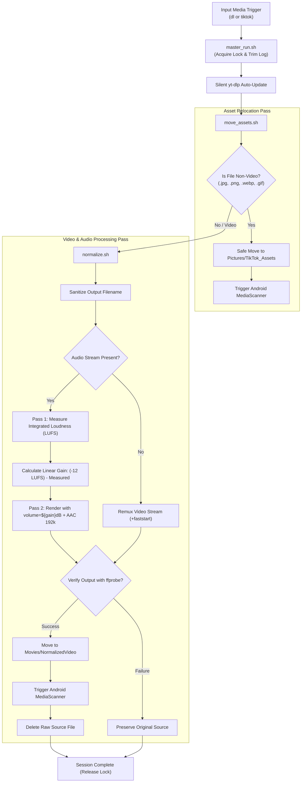

# Termux & PC Media Processing Pipeline

[](LICENSE)
[](#-storage--folder-architecture)
[](download.sh)
[](https://ffmpeg.org/)

An automated, cross-platform media ingestion and audio normalization pipeline. Built natively for **Android (Termux)** and fully compatible with **Windows (PowerShell / CMD)** and **Linux / macOS**.

---

## 📌 Key Highlights

- **Linear Loudness Normalization (-12 LUFS):** Pure constant linear gain with **zero dynamic range compression (DRC)**. Preserves original dynamic range and transient punch without volume pumping.
- **Automated Non-Video Asset Relocation:** Automatically detects image, sticker, and animation assets (`.jpg`, `.png`, `.gif`, `.webp`, `.heic`, `.svg`), relocates them safely to an asset library with collision prevention, and syncs them to Android's native MediaStore.
- **Codec-Aware Stream Optimization:** Bitstream copies compatible H.264/HEVC/MPEG-4 streams (`-c:v copy`) to eliminate generational quality loss and speed up processing.
- **Fail-Safe Ingestion:** Downloads and processed videos are verified for container validity and non-zero duration via `ffprobe` before the original raw file is deleted.
- **Rolling Debug Log:** Automated log rotation enforcing a strict 2MB maximum limit, recycling oldest data to prevent device storage bloat.
- **Single-Instance Process Guard:** Prevents concurrency race conditions using `flock` and atomic directory locks.

---

## 🏗️ Architecture & Pipeline Flow



---

## ⚡ 1-Click Installation

### Option A: Mobile (Android Termux)
Run this single command inside your Termux terminal:

```bash
curl -fsSL https://raw.githubusercontent.com/AnnaMorgrett/Termux/main/install.sh | bash
```

### Option B: Windows (PowerShell)
Clone the repository and run the PowerShell installer:

```powershell
git clone https://github.com/AnnaMorgrett/Termux.git
cd Termux
.\install.ps1
```
*Creates native `dl.cmd` and `tiktok.cmd` commands directly inside your Windows PATH.*

### Option C: Linux / macOS / Git Bash
Clone the repository and run the setup script:

```bash
git clone https://github.com/AnnaMorgrett/Termux.git
cd Termux
bash install.sh
```

---

## 🚀 Unified CLI Usage

The identical commands work across **Android, Windows PowerShell, and Linux**:

### 1. Download & Process (`dl`)
Downloads any URL supported by `yt-dlp` (TikTok, Facebook Reels, YouTube, Instagram, etc.) into the queue and triggers normalization:

```bash
dl "https://www.tiktok.com/@username/video/1234567890"
```
```bash
dl "https://www.facebook.com/share/v/19EB6hTBQM/"
```
*Extra yt-dlp parameters can be forwarded directly (e.g. `dl "https://..." -f bestvideo+bestaudio`).*

### 2. Batch Process Media (`tiktok`)
Scans input folders, relocates images and stickers, and normalizes all pending videos:

```bash
tiktok
```

---

## 📁 Storage & Folder Architecture

The pipeline detects your operating system automatically:

| Component | Android (Termux) | PC (Windows / Linux / macOS) |
| :--- | :--- | :--- |
| **Scripts Directory** | `/storage/emulated/0/Termux/` | Cloned `Termux/` repository directory |
| **Global CLI Binaries** | `$PREFIX/bin/` (`dl`, `tiktok`) | `WindowsApps/` (`dl.cmd`, `tiktok.cmd`) or `~/.local/bin/` |
| **TikTok Input** | `/storage/emulated/0/DCIM/TikTok/` | `~/TermuxMedia/DCIM/TikTok/` |
| **yt-dlp Ingest Queue** | `/storage/emulated/0/Download/yt-dlp/` | `~/TermuxMedia/Download/yt-dlp/` |
| **Relocated Assets** | `/storage/emulated/0/Pictures/TikTok_Assets/` | `~/TermuxMedia/Pictures/TikTok_Assets/` |
| **Final Videos** | `/storage/emulated/0/Movies/NormalizedVideo/` | `~/TermuxMedia/Movies/NormalizedVideo/` |
| **Central Debug Log** | `/storage/emulated/0/Documents/.media_processor.log` | `~/TermuxMedia/Documents/.media_processor.log` |

> **Custom Storage Location:** You can override the root storage directory anytime by setting the `MEDIA_DIR` environment variable:
> - **Bash:** `export MEDIA_DIR="/path/to/custom/media"`
> - **PowerShell:** `$env:MEDIA_DIR = "D:\CustomMedia"`

---

## 🎧 Audio Normalization Methodology

Standard single-pass dynamic normalization filters use compressors and limiters. While they make quiet sounds louder, they introduce audible pumping, alter frequency balance, and squash audio transients.

This pipeline employs an **EBU R128 / ITU-R BS.1770 two-pass linear gain workflow**:

1. **Pass 1 (Measurement):**
   ```bash
   ffmpeg -i input.mp4 -af loudnorm=print_format=json -f null /dev/null
   ```
   Extracts integrated loudness (`input_i`) across the full file duration.

2. **Gain Calculation:**
   $$\text{Gain (dB)} = \text{TARGET\_LUFS} - \text{Measured\_LUFS}$$

3. **Pass 2 (Constant Linear Scaling):**
   ```bash
   ffmpeg -i input.mp4 -af "volume=${gain}dB" -c:a aac -b:a 192k output.mp4
   ```
   Adjusts the entire audio stream by a fixed coefficient, perfectly hitting **-12 LUFS** while keeping the original musical dynamics 100% intact.

---

## ⚙️ Environment Variables & Tuning

Customize pipeline behavior without editing any scripts:

| Variable | Default | Description |
| :--- | :--- | :--- |
| `TARGET_LUFS` | `-12` | Target integrated loudness in LUFS |
| `AUDIO_BITRATE` | `192k` | Audio bitrate for normalized AAC stream |
| `LOG_MAX_BYTES` | `2097152` | Maximum size of `.media_processor.log` before 50% oldest data rotation (2 MB) |
| `MEDIA_DIR` | Auto | Overrides the root storage directory |

---

## 🧩 Script Breakdown

- **[`download.sh`](download.sh)**: Dedicated `yt-dlp` download logic with sane output naming and timestamp flags.
- **[`move_assets.sh`](move_assets.sh)**: Non-video asset scanner and relocator with collision handling and MediaScanner broadcast.
- **[`normalize.sh`](normalize.sh)**: Video codec inspector, audio loudness calculator, linear gain renderer, and integrity verifier.
- **[`master_run.sh`](master_run.sh)**: Orchestration controller managing locks, rotating debug logs, dependency updates, and sequential execution.
- **[`install.sh`](install.sh)**: Cross-platform POSIX installer for Android Termux and Linux/macOS.
- **[`install.ps1`](install.ps1)**: Native Windows PowerShell installer creating Windows CLI wrappers.

---

## 📄 License

This project is licensed under the [MIT License](LICENSE).
